<!-- Header -->
<p align="center">
  
</p>

<p align="center">
  <a href="https://git.io/typing-svg">
    
  </a>
</p>

<p align="center">
  <a href="mailto:rasprogrammer@gmail.com"></a>
  <a href="https://www.linkedin.com/in/rajeev-kumar-2b9767319/"></a>
  <a href="https://x.com/rasprogrammer"></a>
  <a href="https://www.instagram.com/rasprogrammer"></a>
  <a href="https://www.facebook.com/profile.php?id=61561845871105"></a>
</p>

<p align="center">
  
  
  
</p>

---

## 🧑‍💻 About Me

```ts
const rasprogrammer = {
  role: "Full-Stack Developer",
  focus: ["Web Development", "App Development", "Software Development"],
  currentlyLearning: ["AI / LLM Apps", "System Design", "Scalable SaaS Architecture"],
  lookingToCollaborateOn: "AI Development",
  stack: {
    frontend: ["React", "Next.js", "Vue", "Tailwind CSS"],
    backend: ["Node.js", "Express", "PHP"],
    databases: ["MongoDB", "PostgreSQL", "MySQL", "Redis"],
    devops: ["Docker", "Git", "Vercel", "Railway"],
  },
  funFact: "I turn coffee into TypeScript ☕ → 🟦",
};
```

## 🛠️ Tech Stack

<p align="center">
  <a href="https://skillicons.dev">
    
  </a>
  <br/>
  <a href="https://skillicons.dev">
    
  </a>
  <br/>
  <a href="https://skillicons.dev">
    
  </a>
</p>

## 🚀 Featured Projects

<table>
  <tr>
    <td width="50%" valign="top">
      <h3><a href="https://github.com/rasprogrammer/MeshSchema">🧩 MeshSchema</a></h3>
      <p>AI-powered database schema designer: write DBML, see a live ER diagram, export to SQL/PNG/SVG, with Claude-powered generation and real-time multiplayer editing.</p>
      
      
      
      
      
      
    </td>
    <td width="50%" valign="top">
      <h3><a href="https://github.com/rasprogrammer/saas-billing-engine">💳 SaaS Billing Engine</a></h3>
      <p>Starter kit for subscription SaaS: multi-tenant auth, pricing plans, usage metering, plan-aware rate limiting, async invoice PDFs and payment webhooks, plus a dashboard.</p>
      
      
      
      
    </td>
  </tr>
  <tr>
    <td width="50%" valign="top">
      <h3><a href="https://github.com/rasprogrammer/drawsketch">🎨 SKETCH</a></h3>
      <p>Real-time collaborative whiteboard: rooms, shapes and freehand drawing, synced live between users over WebSockets.</p>
      
      
      
      
    </td>
    <td width="50%" valign="top">
      <h3><a href="https://github.com/rasprogrammer/rasmeet">📹 rasMeet</a></h3>
      <p>Video meeting app for real-time calls between users, built with TypeScript.</p>
      
      
    </td>
  </tr>
  <tr>
    <td width="50%" valign="top">
      <h3><a href="https://github.com/rasprogrammer/rasChat">💬 rasChat</a></h3>
      <p>Real-time chat application with Docker-ready deployment.</p>
      
      
    </td>
    <td width="50%" valign="top">
      <h3><a href="https://github.com/rasprogrammer/short-url">🔗 Short URL</a></h3>
      <p>URL shortener that turns long links into short, shareable ones.</p>
      
    </td>
  </tr>
</table>

<p align="center">
  <a href="https://github.com/rasprogrammer?tab=repositories"></a>
</p>

## 📊 GitHub Stats

<p align="center">
  
</p>

<p align="center">
  
  
</p>

<p align="center">
  
</p>

<p align="center">
  
</p>

## 🐍 Contribution Snake

<p align="center">
  <picture>
    <source media="(prefers-color-scheme: dark)" srcset="https://raw.githubusercontent.com/rasprogrammer/rasprogrammer/output/github-snake-dark.svg" />
    <source media="(prefers-color-scheme: light)" srcset="https://raw.githubusercontent.com/rasprogrammer/rasprogrammer/output/github-snake.svg" />
    
  </picture>
</p>

---

<p align="center">
  <b>⭐ If you like my work, consider starring a repo — it keeps me motivated!</b>
</p>


